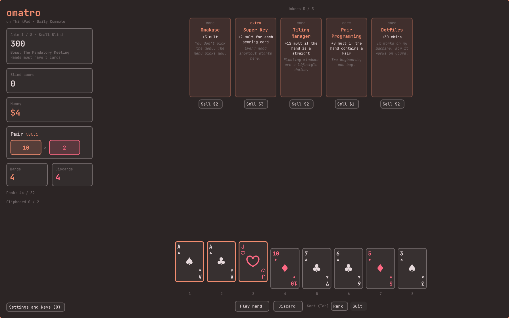

# omatro

A Balatro-like card game for Omarchy: play poker hands to beat blinds, while jokers
multiply the score (chips × mult).



A standalone Qt Quick application, like omawrite or omacut, but written in Rust
(Qt binding with [cxx-qt](https://github.com/KDAB/cxx-qt)):

- `engine/`: the engine (rules, scoring, jokers, shop), with no Qt dependency. It also
  provides an `omatro-engine` binary that speaks the JSON protocol on stdin/stdout.
- `app/`: the application. The QML is embedded in the binary, and the engine is called
  directly, with the same JSON protocol. The active Omarchy theme (colors from
  `colors.toml`, font size from `shell.toml`, Hyprland rounding) is reloaded as soon as
  it changes.
- `pkgbuild/`: launcher entry and icon.

A personal project, unaffiliated with Balatro: the mechanics are borrowed, but not the
name, the artwork, the text or the code. The content is themed around Omarchy, Arch and
Hyprland, with affectionate jokes about DHH; it is unaffiliated with them too.
Names of real people, products and companies belong to their owners; they appear
as affectionate parody.

The code and the music (`app/music`, made by the maintainer with Suno) are under the
MIT license (see [LICENSE](LICENSE)); the license does not cover the names and
trademarks the game mentions. The sound effects (`app/sounds`) come from
[Kenney](https://kenney.nl)'s packs (CC0), or are synthesized by `app/sounds/synth.py`
(MIT, like the code).

## Installation

On Arch Linux and Omarchy, each [release](https://github.com/vianney-g/omatro/releases)
comes with a pacman package, which brings Qt 6 along:

```sh
sudo pacman -U https://github.com/vianney-g/omatro/releases/download/v0.3.1/omatro-0.3.1-1-x86_64.pkg.tar.zst
```

Or build the package from the latest release's source, with pacman tracking it:

```sh
git clone https://github.com/vianney-g/omatro && cd omatro/pkgbuild && makepkg -si
```

Releases also hold a plain archive (binary, launcher entry, icon) for other
distributions, which needs Qt 6 installed.

To build it by hand, you need Rust and Qt 6 (`qt6-base`, `qt6-declarative`,
`qt6-multimedia` and its `qt6-multimedia-ffmpeg` backend for the music; without them
the game is silent).

```sh
make install   # build and install into ~/.local (binary, launcher entry, icon)
omatro
make run       # build and run without installing
make test
```

A new game starts by picking a deck, the machine you play on
([docs/decks.md](docs/decks.md)), in a carousel (←/→): more hands or discards, money,
slots, a deck without face cards, starting pull requests… The last one picked is
remembered.

The game speaks English and French: the system's language by default, L (or the
settings, O) to switch. Card names and quips stay in English.

The game in progress is saved after every move, in `~/.local/state/omatro/save.json`
(`$XDG_STATE_HOME` if set): quit whenever you like, the next start offers to resume it.
A lost game is removed.

Each deck is played at a difficulty level (↑/↓ or Shift+←/→ on the new game screen): eight
levels, from Daily Commute to Hypercar, each adding its rule to those below it (see
[docs/stakes.md](docs/stakes.md)). A deck starts at the first level only; winning a
game with it unlocks its next level, and its card shows the highest level won.

Each game has a seed, a code of letters and digits that deals it again card for card:
fastfetch (I) and the game over screen show it, with a button (or Ctrl+C) to copy it.
Type one in on the new game screen (S) to replay a game or play a friend's; left
empty, the seed is random. A game on a chosen seed counts for no achievement, stat
nor history.

The collection (C, in game or on the new game screen) lists every joker, deck,
consumable, pull request, badge, boss, package, modifier and hand type: each one shows
up once you have obtained it in a game (a joker bought, a badge won, a boss beaten…).
Then come the achievements (see [docs/achievements.md](docs/achievements.md)),
some of which unlock hidden jokers and a hidden deck, absent from games before; the
stats (games won, lost and abandoned, win streak, best ante and hand, games per deck,
hand types played); and the history of the last 50 games (how each one ended, deck,
level, ante, best hand, jokers held). A game left for a new one after its first hand
counts as abandoned; a won game going on in endless mode stays one won game. Games
where a debug cheat was used, or played on a chosen seed, still fill the collection,
but unlock no achievement and count in neither the stats nor the history. The profile is kept in
`~/.local/state/omatro/profile.json`.

The music is lofi, from the maintainer: instrumentals during blinds, songs (with
lyrics, and jokes) everywhere else; each track plays to its end and the next one
follows where you are. M switches it on and off, Shift+M the sound effects (cards,
chips climbing a scale, the PC speaker's beeps when a game is lost…). The settings
(O, from anywhere) set their volumes (←/→ for the music, Shift+←/→ for the sounds)
and the language, and list every key.

Keys: 1 to 9 and 0 to choose cards, Enter to play, D to discard, Tab to sort the hand
by rank or suit, Shift+←/→ to move the selected card (or drag it), J to bring the next
joker to the front when they overlap (or hover or click one), then Shift+←/→ to move it
(or drag it, in the shop and during a blind), Ctrl+N for a new game (starting it
asks again while a game is in progress), I for fastfetch (run
info: the machine and its level, hand levels, cards left), C for the collection, O for the
settings and the list of keys, M for the music, Shift+M for the sound effects, Ctrl+Q
to quit. Before a blind: Enter to play it, S to skip it. Ctrl+1 and Ctrl+2 apply the
consumables of the clipboard. In the shop: 1 to 9 to buy the offers, then the packs,
then the pull requests, in order; Shift+1 to 9 for Use now, which buys a theme or
command and uses it at once; R to reroll, Enter for the next blind. The button under
each joker sells it. Before a boss, B rerolls it (with Change Request). In an open
pack: 1 to 5 (or Install) take a card, Shift+1 to 5 when the pack drew a hand to
select from; Ctrl+C (or Escape) skips. Digit keys go by their place on the keyboard,
so they need no Shift on AZERTY or BÉPO.

## How a game goes

The game is played in antes of three blinds: the small blind, the big blind and the
boss blind. Each blind requires reaching a score within 4 hands and 3 discards: the
ante's base score (300, 800, 2,000, 5,000, 11,000, 20,000, 35,000, 50,000) × 1, 1.5 or
2. Before the small and big blinds, you may skip them, for the badge each one shows
([docs/tags.md](docs/tags.md)): money, free jokers or packs, editions, levels… Some act
right away, others wait for the next shop, blind or boss. Each ante's boss
([docs/bosses.md](docs/bosses.md)) has an effect, announced before the blind: cards that
don't score, cards dealt face down, hands it refuses, a bigger target… Beating the
boss blind of ante 8 wins the game; you may then go on in endless mode, where targets
explode.

Each poker hand type has a level, which raises its starting chips and mult (see
[docs/hands.md](docs/hands.md)); three secret hands need duplicate cards. Themes
([docs/themes.md](docs/themes.md)) level up a hand type: bought in the shop, they wait
in the clipboard (2 slots) until applied, at any time. Commands
([docs/commands.md](docs/commands.md)) change the selected cards, make money or create
things; those that change cards are applied during a blind, with the cards selected.
Oligarchy cards ([docs/oligarchy.md](docs/oligarchy.md)): elite capital, public code.
Powerful, at a price, they only come from oligarchy packs and a few jokers, and
Aspiring Billionaire is the only way to a legendary joker. Your deck lasts
the whole game: every played or discarded card comes back to it after each blind. Cards
may carry an enhancement, a seal and an edition ([docs/modifiers.md](docs/modifiers.md));
hover a card to read them.

A won blind pays $3, $4 or $5, plus $1 per unplayed hand, plus $1 of interest per $5
held ($5 at most). Cash out, then the shop offers 2 cards: each slot holds a theme or
a command ($3, 1 chance in 7 each) or a joker you don't own yet, of a rarity drawn for each slot (core
70%, extra 25%, AUR 5%), sometimes with an edition (5 joker slots,
resold at half price; reroll for $5, then $1 more each time). Jokers trigger left to
right, so their order matters. The shop also sells 2 packs ([docs/packs.md](docs/packs.md)),
opened on the spot: coreutils (commands), base16 (themes), base-devel (cards) and
jokers-git (jokers) and oligarchy (oligarchy cards), in normal, `-full` and `-meta` sizes.
Each ante, the shop also offers a pull request ([docs/vouchers.md](docs/vouchers.md)),
a permanent upgrade for $10: more slots, discounts, hands, discards, interest… You start with $4 and no
jokers.

## Engine alone

```sh
cargo run -p omatro-engine   # reads commands on stdin
```

With `OMATRO_DEBUG=1`, the engine accepts `debug` commands, and the app maps them to
F5 (win the blind in progress), F6 (+$100), F7 (jump to the boss of ante 8), F8 (raise
every known hand type one level), F9 (add a random joker with a random edition), F10
(add a random theme to the clipboard) and F11 (give the cards in hand random
enhancements, seals and editions), F12 (add a random command to the clipboard) and F3 (open a random pack, in the
shop), F2 (add a random oligarchy card), F4 (switch this ante's boss to the next one), F1 (make every joker Welded, Worn and Leased). `OMATRO_JOKERS=uptime,fork` sets the jokers
every new game starts with.

## Protocol

One JSON command per line on standard input, one JSON response per line on output.

| Command | Effect |
|---|---|
| `{"cmd":"new_game","seed":42,"jokers":["dotfiles"],"deck":"thinkpad","stake":"quattro"}` | New game (`seed`, `jokers`, `deck` and `stake` optional; a level the deck hasn't unlocked is refused). `"seed_code":"J6QCWLJK"` instead of `seed` is a seed the player chose (as the state's `seed_code`, any case): the game counts for no achievement, stat nor history |
| `{"cmd":"decks"}` | Lists the decks a new game may start with |
| `{"cmd":"glossary"}` | Lists the terms card texts mention, with what they mean |
| `{"cmd":"collection"}` | The collection, the achievements, the stats and the history, as the profile has them (the app only) |
| `{"cmd":"language","lang":"fr"}` | Sets the language of the responses (`en`, `fr`) and returns the catalog |
| `{"cmd":"saved_game"}` | Tells whether a saved game can be resumed (the app only) |
| `{"cmd":"resume"}` | Resumes the saved game |
| `{"cmd":"state"}` | Returns the state |
| `{"cmd":"select_blind"}` | Plays the blind on offer: deals a hand |
| `{"cmd":"skip_blind"}` | Skips the blind on offer (not the boss) |
| `{"cmd":"play","cards":[0,2,3]}` | Plays 1 to 5 cards (indices into the hand) |
| `{"cmd":"discard","cards":[1]}` | Discards 1 to 5 cards |
| `{"cmd":"preview","cards":[0,2]}` | Hand the selection would make, without playing it |
| `{"cmd":"cash_out"}` | Cashes out a won blind's reward and opens the shop |
| `{"cmd":"buy","offer":0}` | Buys a shop offer |
| `{"cmd":"buy_and_use","offer":0}` | Buys a theme or command of the shop and uses it at once (not those that need cards in hand) |
| `{"cmd":"sell","joker":0}` | Sells a joker (in the shop, before or during a blind) |
| `{"cmd":"move_joker","from":0,"to":2}` | Moves a joker within the row |
| `{"cmd":"move_card","from":7,"to":0}` | Moves a card of the hand (the hand then keeps this order) |
| `{"cmd":"sort_hand","by":"suit"}` | Sorts the hand by `rank` or `suit`, and new hands from now on |
| `{"cmd":"buy_pack","pack":0}` | Buys a pack of the shop and opens it |
| `{"cmd":"pick","choice":0,"cards":[1]}` | Takes a card of the open pack (`cards`: the drawn hand's cards a command changes) |
| `{"cmd":"skip_pack"}` | Leaves the open pack |
| `{"cmd":"buy_voucher","index":0}` | Merges a pull request for sale (in the shop) |
| `{"cmd":"reroll_boss"}` | Draws another boss for the ante (Change Request, before the blind) |
| `{"cmd":"use_consumable","index":0,"cards":[1,3]}` | Uses a consumable of the clipboard (any time but after a loss); `cards`: the hand cards a command changes |
| `{"cmd":"sell_consumable","index":0}` | Sells a consumable of the clipboard |
| `{"cmd":"reroll"}` | Rerolls the shop offers |
| `{"cmd":"next_blind"}` | Leaves the shop for the choice of the next blind |
| `{"cmd":"debug","money":50,"jokers":["hotwire"],"edition":"blur","ante":8,"blind":"boss","win":true,"level_up":["pair"],"random_joker":true,"random_theme":true,"enhance_hand":true,"random_command":true,"random_pack":true,"random_oligarchy":true,"boss":"burnout","next_boss":true,"vouchers":["overtime"],"tags":["build_passing"]}` | Testing shortcuts, all fields optional; only with `OMATRO_DEBUG=1` |

Responses:

- `{"event":"state","state":{…}}`: game state: `seed`, `seed_code` (the seed as shown
  to the player, in base 36), `seeded` (the player chose it), `run_deck` (the deck picked, or `null`), `ante`, `blind` (`small` / `big` /
  `boss`), the ante's three `blinds` (name, the boss's `description`, target, reward,
  `status`, and the `tag` skipping it gives), the ante's `boss` and `boss_active`, `target`, `score`,
  hands and discards left (in the `pack` phase, the hand is the one a coreutils pack
  drew; `face_down`, `debuffed` and `forced` follow the hand's cards), `remaining` (cards left to draw, or the whole deck between
  blinds), `deck_size`, `sort_by` (`rank` or `suit`), `hands` (each hand type's `level`, `chips`, `mult` and `played`
  count; secret hands only once played), `phase` = `blind_select` / `playing` / `won` / `shop` /
  `pack` / `lost`, `victory` (the winning ante's boss was just beaten), hand, `hand_size`,
  jokers (`id`, `name`, `description`, `quip`, `rarity`, `edition`, `price`,
  `sell_value`, `bonus` for what a growing joker gives now, `current` for what a Fork
  copies), `max_jokers`, `jokers_hidden`, `disabled_joker`, `vouchers` merged, `vouchers_for_sale` (in
  the shop), `tags` (badges won, waiting; a blind's `tag` too, with `current` for what it would give now), `boss_reroll_cost` (when Change Request allows it now), `modifiers` (names and effects of every enhancement, seal and
  edition), `consumables` (`kind` = `theme` / `command` / `oligarchy`, `id`, `name`,
  `description`, `quip`, `price`, `sell_value`, `min_cards` / `max_cards` to select,
  `needs_hand` when it works on the cards in hand, `transparent` when it takes no slot,
  `current` for what it would do now: a theme's next level, money, what Up Arrow recalls), `consumable_slots`, `unique_themes`, `money` (below $0 with Cloud Credits, down to `-credit`),
  `reward` in the `won` phase (with `cards` for Enterprise cards held, `discards` for
  the Raspberry Pi's unused discards, and `notes` such
  as "Beta Release broke."), `shop` offers
  (jokers, consumables or `{"kind":"card","card":…,"price":n}`, told apart by `kind`), `packs` for sale, and `opened`: the
  pack being opened (`name`, `description`, `picks_left`, `with_hand`, and its
  `choices`: consumables, jokers or `{"kind":"card","card":…}`) and `reroll_cost` in the shop. Scores and
  targets are floats; an infinite target (from ante 39) is `null`.
- `{"event":"scored","score":{…},"state":{…}}` after `play`: played cards, recognized
  hand and its `hand_name` and `hand_level`, scoring cards, base chips and mult, then `steps` (each
  trigger, with chips and mult afterwards) to animate the calculation, and the `total`.
  A step's `source` is a played `card`, a `held` card or a `joker`; its `effect` is
  `{"chips":n}`, `{"mult":n}`, `{"x_mult":n}`, `{"money":n}`, `"again"` (a retrigger) or
  `"debuffed"` (the boss keeps the card from scoring) or `"balance"` (a `deck` source:
  Hyprland Dwindle evens out chips and mult).
  `money` is what the hand earned, `notes` what happened to the jokers.
- `{"event":"preview","cards":[…],"hand":"pair","hand_name":"Pair","hand_level":1,"scoring":[…],"base_chips":10,"base_mult":2.0}`
  (`hand` is `null` when nothing is chosen, `scoring` holds hand indices), with
  `bonuses`: each joker's badge if this hand were played.
- `{"event":"decks","decks":[…]}` after `decks`: each deck's `id`, `name`,
  `description` and `quip`; a hidden deck not unlocked yet has the `achievement` it
  waits for and its `condition` (otherwise `null`), and `new_game` refuses it; its
  `best_stake` (highest level won, or `null`) and `top_stake` (highest level it may
  be played at). Then the `stakes`: each level's `id`, `level`, `name`,
  `description`, `quip` and `rules` (what applies at it). The state's `stake` is the
  game's level, in the same form; jokers carry their `stickers` (`id`, `name`,
  `description`, and a Worn joker's `blinds_left`).
- `{"event":"collection","collection":{…}}` after `collection`: `found` and `total`,
  the `families` (each with its `id`, `name`, `found`, `total` and `items`: `id`,
  `state` (`found`, `unknown`, or `locked` until an achievement), `secret`, and once
  found `name`, `description`, `quip` and a joker's `rarity`; a locked item's
  `achievement` and `condition`), then the `achievements` (`id`, `name`,
  `description`, `quip`, `done`, `progress` and `goal` for counting ones, `unlocks`
  once done or `unlocks_family` before), the `stats` (`games`, `won`, `lost`,
  `abandoned`, `streak`, `best_streak`, `best_ante`, `best_hand`, `blinds_won`,
  `hands_played`, `jokers_sold`, `decks`: `deck` (null for the plain deck), `games`,
  `won`, `best_ante`, `best_stake`; `hands`: `kind`, `hand_name`, `played`) and the
  `history`, the last game first (`ended` in seconds since 1970, `seed`, `seed_code`, `deck`,
  `stake`, `outcome`: `won`, `lost` or `abandoned`, `ante`, `boss` that ended it,
  `best_hand`, `hand_name` played most, `jokers`).
- Any response may carry `news`: what the profile just gained, each with its `kind`
  (`found`, `achievement`, or `unlocked` for a hidden item), `name` and `text` (the
  item's family, or what the achievement took).
- `{"event":"glossary","terms":[…]}` after `glossary`: each term's `name`, `kind`
  (`edition`, `pull request`, `joker · AUR`…) and `description` (empty for hand
  types, listed only so that a shorter name never matches inside them).
- `{"event":"saved_game","state":{…},"problem":null}` after `saved_game`: the saved
  game's state (`null` without one), or the `problem` that keeps it from being resumed.
- `{"event":"language","lang":"fr","table":{…},"languages":[…]}` after `language`: the
  catalog (English text → translation, `{name}` slots in templates) for the
  interface's own text, and the languages to choose from.
- `{"event":"error","message":"…"}`.

The hand is always sorted by descending rank.

Cards are written `{"rank":14,"suit":"spades","id":51,"enhancement":"daemon","seal":"retry","edition":null,"bonus_chips":5}`
(rank 2 to 14: 11 jack, 12 queen, 13 king, 14 ace; `id` tells apart the cards of the
deck; `enhancement`, `seal` and `edition` are ids or `null`, `bonus_chips` what the card
gained).

## Jokers

See [docs/jokers.md](docs/jokers.md) and [docs/editions.md](docs/editions.md),
generated from the engine code.
